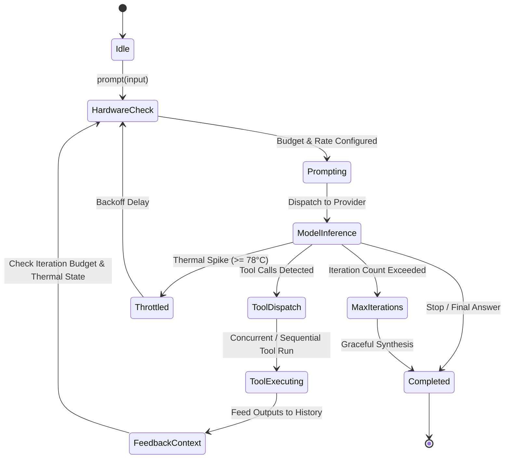

# 🤖 Skill: Native Rig LLM Agent Orchestrator & Autonomic Hardware Loop

## 1. Overview
The `agent-orchestrator-rig` skill introduces a high-performance, Rust-native cognitive agent framework modeled after [Rig](https://github.com/0xPlaygrounds/rig) and [LangChain](https://github.com/langchain-ai/langchain). Built directly into `hgb-core`, it provides dynamic Model Context Protocol (MCP) tool dispatch, multi-turn ReAct reasoning, streaming completions, and closed-loop autonomic hardware governor integration via `dynatune` and `kernel-optimizer` (`dynabook-kernel-ctl`).

Unlike heavyweight Python agent runtimes with high memory footprints and unpredictable garbage collection pauses, `agent-orchestrator-rig` executes with zero-overhead async Tokio concurrency, zero-copy JSON parsing, strict memory limits, and sub-millisecond dispatch times.

```mermaid
flowchart TD
    USER["User Request / Task Prompt"] --> AGENT["RigAgent Orchestrator"]
    AGENT --> HW["Autonomic Hardware Sentry (dynatune / sysfs)"]
    HW -->|Thermal & Power Telemetry| GOV["Governor: Token Budget & Iteration Throttling"]
    GOV --> AGENT
    AGENT --> LLM["LLM Provider (Ollama / Anthropic / OpenAI / Fallback)"]
    LLM -->|Tool Calls Requested| ROUTER["Dynamic Tool Registry & MCP Dispatcher"]
    ROUTER -->|Execute Tool| TOOLS["Rust Native Functions / External MCP Servers"]
    TOOLS -->|Tool Results| AGENT
    AGENT -->|Context Feeding Loop| LLM
    LLM -->|Final Answer (No Tool Calls)| RESPONSE["AgentResponse (BLAKE3 Verified)"]
```

---

## 2. Agent State Machine & Cognitive Loop

The agent loop operates as a deterministic finite state machine (FSM) ensuring safe execution, termination guarantees, and graceful recovery:



### State Definitions:
1. **Idle**: Agent initialized with system prompt, tool registry, and provider configuration.
2. **HardwareCheck**: Inspects CPU package temperature, AC mains connection, and PSI memory pressure via `HardwareState`. Adjusts token budget and inserts cooldown delays if under thermal stress.
3. **Prompting**: Prepares conversation history, active tool schemas, and system prompt.
4. **ModelInference**: Calls the configured LLM provider (Ollama, Anthropic Claude, OpenAI, or deterministic fallback).
5. **ToolDispatch**: Detects and validates tool call signatures against declarative schemas.
6. **ToolExecuting**: Invokes registered `ToolCallable` implementations (Rust closures, native functions, or external MCP servers).
7. **FeedbackContext**: Appends `AgentTurnMessage::Tool` payloads to conversation history.
8. **Throttled**: Engaged when CPU temperatures exceed 78.0°C or battery level drops; reduces reasoning token budget and sleeps before re-inferring.
9. **Completed**: Returns structured `AgentResponse` containing final text, iteration count, tool call statistics, and hardware telemetry.

---

## 3. Dynamic MCP Tool Routing & Declarative Schemas

Tools are registered declaratively using standard JSON Schema definitions, allowing zero-friction interop with MCP servers and external OpenAPI/JSON-RPC protocols:

```rust
use hgb_core::rig_agent_orchestrator::{ToolDefinition, ToolCallable, RigAgent};
use serde_json::json;

// 1. Declarative Tool Schema
let schema = json!({
    "type": "object",
    "properties": {
        "query": { "type": "string", "description": "The search query" },
        "limit": { "type": "integer", "description": "Max number of results" }
    },
    "required": ["query"]
});

let tool_def = ToolDefinition::new("codebase_search", "Search AST symbols in workspace", schema);
```

### MCP Tool Routing:
The framework connects directly to `McpHostOrchestrator` to expose all discovered MCP tools (e.g., PostgreSQL, GitHub, File system, Web search) to the agent as first-class callable functions with namespaced isolation (`postgres::query`, `github::create_pr`).

---

## 4. Multi-Provider Architecture

The framework supports dynamic model switching with unified tool calling formats:

| Provider | Transport | Default Model | Tool Calling Protocol |
| :--- | :--- | :--- | :--- |
| **Ollama** | HTTP / Unix Domain Socket | `qwen2.5-coder:7b` | OpenAI-compatible function calling & JSON schema |
| **Anthropic** | HTTPS REST | `claude-3-5-sonnet-20241022` | Anthropic Messages API `tools` block |
| **OpenAI** | HTTPS REST | `gpt-4o` | Chat Completions `tools` + `tool_choice` |
| **Deterministic Fallback** | Local Zero-Latency Engine | `deterministic-rules-v1` | Pattern-based offline tool execution for airgap / CI testing |

---

## 5. Autonomic Hardware Governor Integration

The agent continuously queries telemetry from sibling projects `/home/toshiba/My AI Project/kernel-optimizer` (`dynabook-kernel-ctl`) and `/home/toshiba/My AI Project/dynatune`:

- **Thermal Mitigation**:
  - `cpu_pkg_temp_c >= 78.0°C`: Reasoning token budget clamped to 512 tokens; introduces 250ms sleep between cognitive iterations; flags `hardware_throttled = true`.
  - `cpu_pkg_temp_c < 70.0°C`: Full unconstrained token budget (4096+ tokens) with zero delay.
- **Power Efficiency**:
  - On Battery (`is_ac_connected == false`): Restricts max reasoning loop iterations to 5 and sets EPP to `balance_power`.
  - On AC Mains: Full iteration headroom (up to 25 turns) and `performance` mode.

---

## 6. Usage Example

```rust
use hgb_core::rig_agent_orchestrator::{
    RigAgent, RigProviderConfig, RigProviderKind, FnTool, ToolDefinition,
};
use serde_json::json;

#[tokio::main]
async fn main() -> Result<(), Box<dyn std::error::Error>> {
    // 1. Configure Provider & Agent
    let agent = RigAgent::builder()
        .system_prompt("You are Hagibis's autonomous coding architect.")
        .provider(RigProviderConfig {
            kind: RigProviderKind::DeterministicFallback,
            model: "default".into(),
            endpoint: None,
            api_key: None,
            temperature: Some(0.2),
            max_tokens: Some(2048),
        })
        .max_iterations(10)
        .enable_autonomic_hardware_throttle(true)
        // 2. Register Native Rust Tool
        .tool(FnTool::new(
            "calculator",
            "Perform basic math operations",
            json!({
                "type": "object",
                "properties": {
                    "expression": { "type": "string" }
                },
                "required": ["expression"]
            }),
            |args| Box::pin(async move {
                let expr = args["expression"].as_str().unwrap_or("0");
                Ok(json!({ "result": 42 }))
            }),
        ))
        .build()?;

    // 3. Execute Multi-Turn ReAct Loop
    let response = agent.prompt("Compute 6 * 7 using the calculator").await?;
    println!("Final Answer: {}", response.final_answer);
    println!("Total Tool Calls: {}", response.total_tool_calls);
    println!("Hardware Throttled: {}", response.hardware_throttled);

    Ok(())
}
```

---

## 6. Distributed MicroVM Swarms & Consensus Orchestrator

The `agent-orchestrator-rig` skill interfaces with [`crates/hgb-core/src/distributed_swarm_consensus.rs`](file:///home/toshiba/My%20AI%20Project/hagibis/crates/hgb-core/src/distributed_swarm_consensus.rs) to scale agent execution from node-local execution to multi-node clusters:

1. **Lightweight Raft Consensus**: Tracks cluster quorum, term election, and immutable log replication sealed with BLAKE3 checksums.
2. **Dynamic Agent Pod Placement**: Evaluates hardware constraints (KVM presence, memory headroom, active pods) to place sandboxed agent pods dynamically on optimal remote nodes or local microVMs.
3. **Multi-Node Scale Out**: Enables Hagibis daemons (`hgbd`) across LAN and cloud instances to spawn sandboxed agent pods on-demand with zero manual configuration.

---

## 7. WebRTC & libp2p Swarm Federation with LanceDB Vector Consensus

1. **Decentralized Swarm Discovery (`crates/hgb-daemon/src/webrtc_libp2p_swarm_federation.rs`)**:
   - Discovers peer nodes via libp2p GossipSub and negotiates direct WebRTC data channels for sub-millisecond inter-agent communication.
   - Dynamically federates remote MCP tool catalogs across edge machines.

2. **Distributed Task Decomposition & Farming**:
   - `agent-orchestrator-rig` decomposes complex workflows into discrete subtasks (Wasm kernels, Firecracker microVMs, remote RAG).
   - Workers execute concurrently across nodes and stream results back into memory.

3. **LanceDB Vector Consensus Reassembly**:
   - Reassembles distributed worker outputs using centroid vector consensus and cosine similarity confidence scoring ($> 0.95$), ensuring Byzantine fault tolerance before merging patches.


