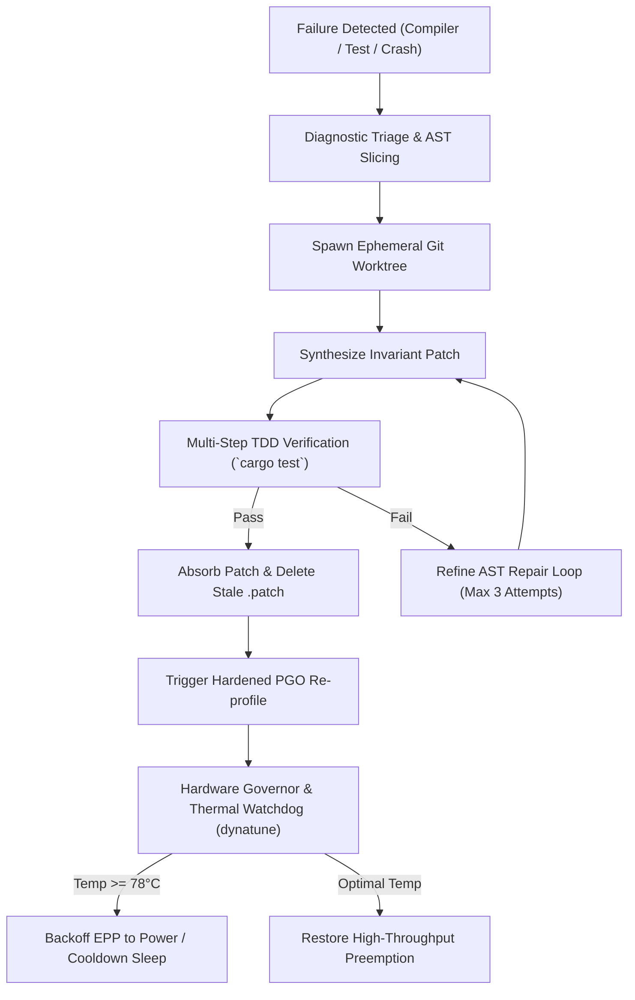

# 🛡️ Skill: Autonomous Diagnostic, PGO Profiling, Patch Absorption & Autonomic Hardware Governor

## 1. Overview
The `self-healing-loop` skill establishes autonomous self-repair, continuous optimization, and autonomic hardware governor loops within Hagibis. When compilation errors, runtime panics, or flaky test failures occur, the skill captures diagnostic telemetry, isolates remediation inside temporary git worktrees, synthesizes invariant-preserving patches, verifies them via multi-step TDD, and cleanly absorbs changes into the codebase without leaving dead `.patch` files behind.

Furthermore, it integrates closed-loop bare-metal hardware thermal and power monitoring via sibling systems `/home/toshiba/My AI Project/kernel-optimizer` (`dynabook-kernel-ctl`) and `/home/toshiba/My AI Project/dynatune`.

## 2. Autonomous Healing Pipeline



### Key Pillars:
1. **Crash Triage & Flaky Exterminator**:
   - Integrates with `crates/hgb-core/src/crash_triage.rs` and `crates/hgb-core/src/flaky_exterminator.rs`.
   - Parses Rust backtraces, compiler error codes, and thread panic payloads to pinpoint responsible modules.
2. **Patch Absorption & Dead Patch Retirement**:
   - Strictly enforces the `ARCH-003` zero dead patches invariant.
   - When external or nightshift agents output patch diffs, the self-healing skill immediately merges their functionality into target source crates and deletes stale patch files.
3. **PGO (Profile-Guided Optimization) Continuous Tuning**:
   - Automates the 4-step PGO lifecycle (`make pgo`):
     1. Build with `-Cprofile-generate`.
     2. Train on synthetic benchmark workloads (`pgo_workload`).
     3. Merge `.profraw` traces into `merged.profdata` using `llvm-profdata`.
     4. Compile final hardened binaries with `-Cprofile-use` and Fat LTO.
4. **Closed-Loop Hardware Thermal & Power Governor**:
   - Interacts with `/home/toshiba/My AI Project/kernel-optimizer` (`dynabook-kernel-ctl`) and `/home/toshiba/My AI Project/dynatune`.
   - Real-time sysfs thermal polling (`/sys/class/thermal/thermal_zone*/temp`) and throttle counters.
   - **Thermal Spike Mitigation (>= 78.0°C)**:
     - Automatically downscales CPU governor to `powersave` and EPP to `power`.
     - Clamps LLM reasoning token budget from 4096 down to 512 tokens.
     - Inserts 250ms cooling pauses between agent reasoning turns.
     - Triggers automated PGO training passes (`scripts/pgo-optimize.sh`) to eliminate hot-spot branch mispredictions and reduce CPU thermal dissipation.
   - **Battery Conservation Mode**:
     - Detects AC disconnection (`/sys/class/power_supply/AC*/online == 0`).
     - Constrains maximum reasoning turns to 5 iterations and clamps EPP to `balance_power`.

## 3. Autonomous Diagnostic Tools (MCP Schema)
The skill exposes the following MCP actions:
- `hgb_self_heal_triage`: Categorizes runtime panic logs and compiler diagnostics into actionable remediation vectors.
- `hgb_self_heal_worktree`: Spins up an isolated ephemeral git worktree branch for safe test-driven code evolution.
- `hgb_self_heal_absorb_patch`: Cleanly merges `.patch` files into source crates, runs verification, and unlinks the patch file.
- `hgb_self_heal_pgo_cycle`: Coordinates instrumented training and profile generation with bare-metal hardware dynatuning.
- `hgb_hardware_thermal_sentry`: Inspects real-time CPU package temperature, AC mains connection, and adjusts token budgets and cooling pauses.
- `hgb_kernel_optimizer_apply`: Invokes `dynabook-kernel-ctl` to enforce preemption modes, MGLRU aging, and energy performance profiles.

## 4. Usage Example
```rust
use hgb_core::nightshift_pipeline::{NightShiftPipeline, NightShiftPipelineReport};
use hgb_core::rig_agent_orchestrator::{HardwareGovernor, RigThermalStatus};

// 1. Inspect real-time hardware status before autonomous run
let hw = HardwareGovernor::sample();
println!("Current CPU Temp: {:.1}°C, Status: {:?}", hw.cpu_pkg_temp_c, hw.thermal_status);

if hw.thermal_status == RigThermalStatus::Critical {
    println!("System throttled. Awaiting thermal cooldown before starting patch cycle.");
}

// 2. Launch autonomous nightshift verification pipeline
let pipeline = NightShiftPipeline::new(".");
let report = pipeline.run("absorb-patches-and-verify", "main");
assert!(report.ready_for_review);
```

---

## 5. Closed-Loop Self-Hosting PGO & Runtime Hot-Swapping

The `self-healing-loop` skill directly wires into [`crates/hgb-daemon/src/self_healing_pgo_rewriter.rs`](file:///home/toshiba/My%20AI%20Project/hagibis/crates/hgb-daemon/src/self_healing_pgo_rewriter.rs):
1. **Continuous Telemetry Profiling**: Tracks execution hot-paths and latency regressions during multi-agent workloads.
2. **Autonomous Recompilation Trigger**: Automatically invokes `scripts/pgo-optimize.sh` when latency regressions (>25%) or hotspot invocations (>1000) occur.
3. **Zero-Downtime Hot-Swap**: Replaces live binaries and WASM microkernels using atomic filesystem symlink swaps with automatic rollback if health probes fail.

---

## 6. Autonomous Evolutionary Code Loop (Pillar 3)

The evolutionary cycle integrates `crates/hgb-daemon/src/autonomous_evolutionary_loop.rs`:
- **Diagnostic Capture**: Detects unit test failures, compiler errors, or latency regressions in real time.
- **Untangle Invariant Check**: Enforces CaldoAI 100/100 DAG layering and crate boundaries.
- **Local Hybrid Inference**: Invokes `HybridCandleOnnxPipeline` (`crates/hgb-core/src/hybrid_candle_onnx_pipeline.rs`) to synthesize surgical diff patches.
- **Firecracker MicroVM Isolation**: Spawns an isolated ephemeral VM (or Landlock CoW sandbox) to test patches in complete isolation.
- **PGO Benchmark Gate & Atomic Hot-Reload**: Benchmarks performance to avoid regressions, then atomically reloads compiled Wasm kernels into the live daemon.

---

## 7. Native Agentic Self-Compilation & Predictive Prefetching

1. **Agentic Self-Compiler (`crates/hgb-daemon/src/agentic_self_compiler.rs`)**:
   - Synthesizes freestanding Zig or Rust source code when novel, unhandled tasks occur.
   - Compiles dynamically to WebAssembly and verifies safety invariants inside `FirecrackerEphemeralSandbox`.
   - Hot-reloads the newly validated Wasm skill into the live daemon without restarts.

2. **Predictive Prefetching Engine (`crates/hgb-nextgen/src/predictive_prefetch_engine.rs`)**:
   - Online Markov chain transitions anticipate next actions ($P \ge 60\%$).
   - Speculatively pre-warms Firecracker microVM snapshots, pre-loads vector memories into RAM, pre-compiles Wasm kernels, and pre-ramps CPU governors before the user or agent even executes the command.

---

## 8. Native eBPF Kernel Anomaly Interception & MicroVM Workload Eviction

1. **eBPF Anomaly Sentry (`crates/hgb-core/src/ebpf_kernel_probe_loader.rs`)**:
   - Sub-microsecond detection of memory thrashing (high PSI pressure), kernel lockups / deadlocks, and thermal spikes.
   - Autonomic triggering of CPU governor down-throttling or boosting.

2. **Automated Firecracker Workload Eviction (`crates/hgb-daemon/src/ebpf_autonomic_healer.rs`)**:
   - Automatically migrates thrashing or anomalous processes into isolated Firecracker microVM sandboxes (`FirecrackerEphemeralSandbox`) without human intervention.


