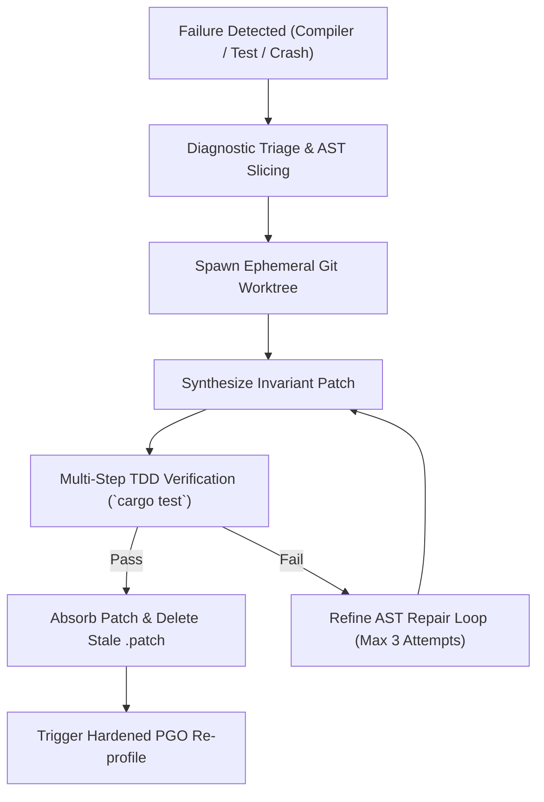

# 🛡️ Skill: Autonomous Diagnostic, PGO Profiling & Patch Absorption

## 1. Overview
The `self-healing-loop` skill establishes autonomous self-repair and continuous optimization loops within Hagibis. When compilation errors, runtime panics, or flaky test failures occur, the skill captures diagnostic telemetry, isolates remediation inside temporary git worktrees, synthesizes invariant-preserving patches, verifies them via multi-step TDD, and cleanly absorbs changes into the codebase without leaving dead `.patch` files behind.

## 2. Autonomous Healing Pipeline



### Key Pillars:
1. **Crash Triage & Flaky Exterminator**:
   - Integrates with `crates/hgb-core/src/crash_triage.rs` and `crates/hgb-core/src/flaky_exterminator.rs`.
   - Parses Rust backtraces, compiler error codes, and thread panic payloads to pinpoint responsible modules.
2. **Patch Absorption & Dead Patch Retirement**:
   - Strictly enforces the `ARCH-003` zero dead patches invariant.
   - When external or nightshift agents output patch diffs (e.g. `update_nightshift.patch`, `update_viral.patch`), the self-healing skill immediately merges their functionality into the target source files (`crates/hgb-core/src/...`) and deletes the root patch file.
3. **PGO (Profile-Guided Optimization) Continuous Tuning**:
   - Automates the 4-step PGO lifecycle (`make pgo`):
     1. Build with `-Cprofile-generate`.
     2. Train on synthetic benchmark workloads (`pgo_workload`).
     3. Merge `.profraw` traces into `merged.profdata` using `llvm-profdata`.
     4. Compile final hardened binaries with `-Cprofile-use` and Fat LTO.

## 3. Autonomous Diagnostic Tools (MCP Schema)
The skill exposes the following MCP actions:
- `hgb_self_heal_triage`: Categorizes runtime panic logs and compiler diagnostics into actionable remediation vectors.
- `hgb_self_heal_worktree`: Spins up an isolated ephemeral git worktree branch for safe test-driven code evolution.
- `hgb_self_heal_absorb_patch`: Cleanly merges `.patch` files into source crates, runs verification, and unlinks the patch file.
- `hgb_self_heal_pgo_cycle`: Coordinates instrumented training and profile generation with bare-metal hardware dynatuning.

## 4. Usage Example
```rust
use hgb_core::nightshift_pipeline::{NightShiftPipeline, NightShiftPipelineReport};

// Launch autonomous nightshift verification pipeline
let pipeline = NightShiftPipeline::new(".");
let report = pipeline.run("absorb-patches-and-verify", "main");
assert!(report.ready_for_review);
```
