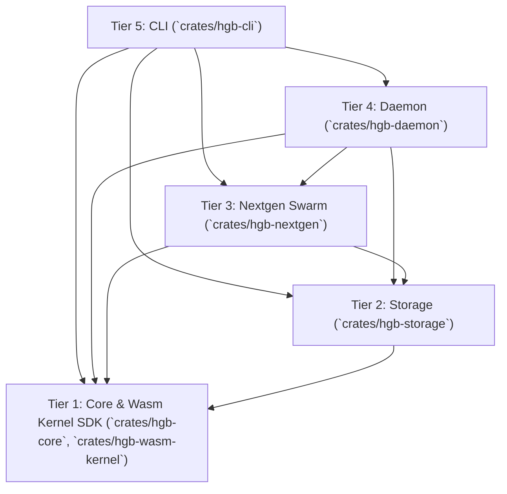

# 🧩 Skill: Untangle Codebase & Architectural Governance

## 1. Overview
The `untangle-codebase` skill provides automated, deterministic architectural analysis and enforcement for the multi-crate Hagibis autonomous engine. It ensures that codebase boundaries remain decoupled, modular, and acyclic according to the CaldoAI atomic capability isolation model.

## 2. Workspace Layer Ordering Specification
The Hagibis crate ecosystem strictly enforces a downward-only 5-tier architectural hierarchy:



### Layer Rules:
1. **Tier 1 - Foundation Core & Kernel SDK (`hgb-core`, `hgb-wasm-kernel`, `wat`)**:
   - Leaf foundation. `hgb-wasm-kernel` provides freestanding guest ABI and tensor types.
   - MUST NOT depend on `hgb-storage`, `hgb-nextgen`, `hgb-daemon`, or `hgb-cli` in production dependencies.
2. **Tier 2 - Persistence & Storage Engine (`hgb-storage`)**:
   - Provides SQLite, WAL, FTS5, and vector indexing.
   - Depends only on Tier 1 (`hgb-core`, `hgb-wasm-kernel`).
   - MUST NOT depend on `hgb-nextgen`, `hgb-daemon`, or `hgb-cli`.
3. **Tier 3 - Advanced Agents & UI Pipelines (`hgb-nextgen`)**:
   - Multi-agent swarm orchestration and UI pipelines.
   - May depend on `hgb-core` and `hgb-storage`.
   - Production dependencies MUST NOT depend on `hgb-daemon` or `hgb-cli`.
4. **Tier 4 - Service Daemon (`hgb-daemon`)**:
   - Long-running background daemon and IPC server.
   - May orchestrate `hgb-core`, `hgb-storage`, and `hgb-nextgen`.
   - MUST NOT depend on `hgb-cli`.
5. **Tier 5 - Entrypoint Command Line (`hgb-cli`)**:
   - May consume all lower layers to drive the user interface.

## 3. Audit Rules & Invariants
The analyzer runs the following static checks:

| Rule ID | Check Name | Description | Severity |
|---------|------------|-------------|----------|
| `ARCH-001` | Layer Ordering Invariant | Crates can only depend on crates in equal or lower tiers. | CRITICAL |
| `ARCH-002` | Circular Dependency Check | The workspace crate dependency graph must form a strict Directed Acyclic Graph (DAG). | BLOCKER |
| `ARCH-003` | Dead Patch Hygiene | No `.patch` or `.diff` files may linger in the workspace root or crate directories without being absorbed or cataloged. | HIGH |
| `ARCH-004` | Leaky SQL Abstraction | Higher-tier crates (`hgb-cli`, `hgb-daemon`) must not embed raw SQL or direct DB connections; all persistence must route through `hgb-storage`. | MEDIUM |
| `ARCH-005` | WIT / MCP Schema Integrity | All MCP server manifests (`hagibis.mcp.json`) and WebAssembly Interface Types (`wit/*.wit`) must be parseable, complete, and syntactically valid. | HIGH |

## 4. Execution
Run the automated analyzer:
```bash
python3 skills/untangle-codebase/scripts/untangle_analyzer.py --workspace .
```

To run in strict CI mode (exits non-zero on any warning):
```bash
python3 skills/untangle-codebase/scripts/untangle_analyzer.py --workspace . --strict
```

To produce a machine-readable JSON digest:
```bash
python3 skills/untangle-codebase/scripts/untangle_analyzer.py --workspace . --json
```

## 5. Autonomous Evolutionary Loop Integration
When `AutonomousEvolutionaryLoop` (`crates/hgb-daemon/src/autonomous_evolutionary_loop.rs`) captures a failing test or latency regression, it programmatically invokes `audit_codebase_untangle()` prior to patch synthesis. This ensures:
- Surgical patch modifications adhere strictly to DAG invariants `ARCH-001` and `ARCH-002`.
- Zero circular references are introduced between `hgb-core`, `hgb-storage`, `hgb-nextgen`, and `hgb-daemon`.
- Crate isolation is certified before candidate patches are verified in ephemeral Firecracker microVMs.

