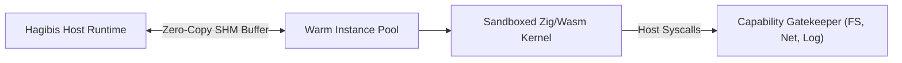

# ⚡ Skill: Decoupled Zig Wasm Kernel & Sandboxed Capability Runner

## 1. Overview
The `wasm-kernel-zig` skill provides high-performance, sandboxed WebAssembly execution for untrusted plugins, agent-generated tools, and compute-heavy kernels. By combining a freestanding Zig compilation pipeline with Wasmtime instance pooling and zero-copy shared memory, it achieves native execution performance with sub-millisecond dispatch times and mathematical isolation.

## 2. Core Capabilities & Architecture



### Key Pillars:
1. **Decoupled Zig Kernel**:
   - Compiles native compute primitives (BPE tokenization, SIMD dot products, matrix-vector multiplications) via:
     ```bash
     zig build-lib -target wasm32-freestanding -OReleaseFast -dynamic hgb_kernel.zig
     ```
   - Exports deterministic C-ABI symbols (`hgb_alloc`, `hgb_dealloc`, `hgb_shm_attach`, `hgb_compute_vector_similarity`).
2. **Instance Pooling & Zero-Allocation Execution**:
   - Maintains an in-memory pool of pre-warmed, pre-instantiated Wasmtime instances.
   - Resets linear memory pages without dropping the compiled module, reducing per-invocation latency from ~15ms to <200µs.
3. **Zero-Copy Shared Memory (`ShmBufferDescriptor`)**:
   - Bidirectional 1 MiB ring buffer exchange between host and guest.
   - Eliminates serde serialization overhead for tensor payloads, prompt tokens, and large code ASTs.
4. **Fine-Grained Capability Sandboxing**:
   - Strict memory ceiling (default 32 MiB, hard cap 512 MiB).
   - Instruction fuel budgeting preventing infinite loops or denial of service.
   - Syscall filtering (`fs_read`, `fs_write`, `net_fetch`, `host_log`) gated by explicit security policy.

## 3. WebAssembly Interface Types (WIT)
The capability is formalized in `wit/wasm-kernel.wit`:
- Imports: `host-syscalls` for capability-controlled IO.
- Exports: `kernel-abi` for plugin lifecycle, tool invocation, tokenization, and vector math.

## 4. Usage Example
```rust
use hgb_core::micro_sandbox::{MicroSandboxConfig, SandboxCapability};
use hgb_wasm_kernel::{BpeTokenizer, ShmBufferDescriptor, hgb_shm_attach};

// Initialize BPE Tokenizer inside kernel
let tokenizer = BpeTokenizer::new_default();
let tokens = tokenizer.encode("fn calculate_similarity() -> f32");
assert!(!tokens.is_empty());
```
